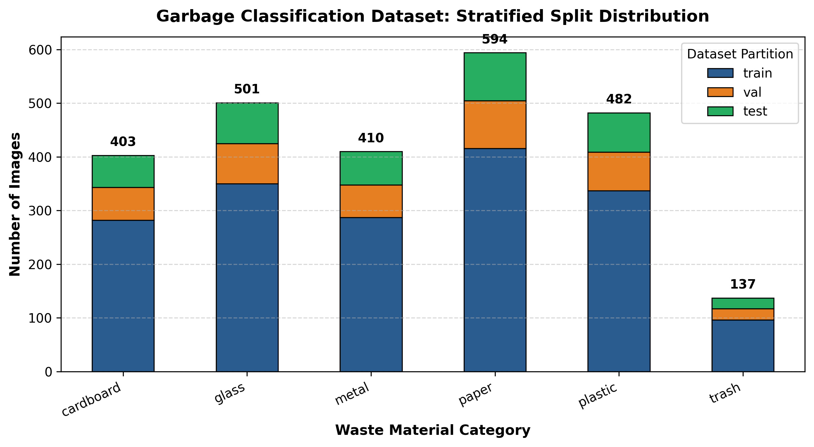
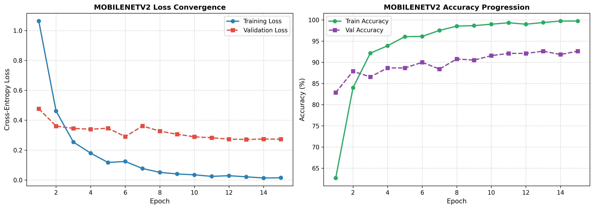
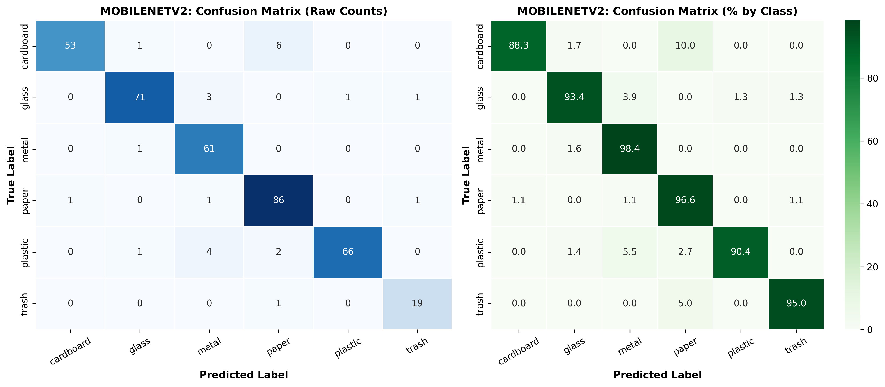
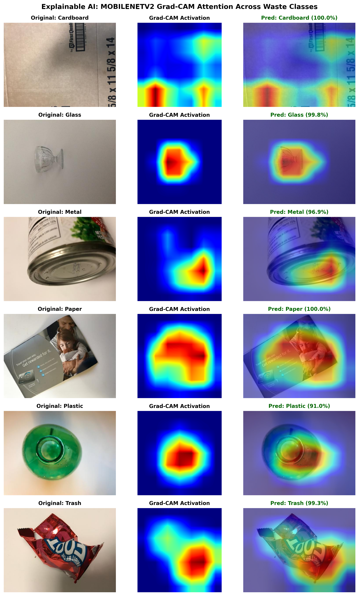

<div align="center">

# ♻️ Automated Waste Classification System
### Deep Learning & Computer Vision for Municipal Recycling Stream Automation
**PART B — DEEP LEARNING | Week 2: Neural Networks and Intelligent Applications**  
*A Comparative Study of Custom Convolutional Architectures and Transfer Learning with Explainable AI (Grad-CAM)*

[](https://www.python.org/downloads/)
[](https://pytorch.org/)
[-76B900.svg)](https://developer.nvidia.com/cuda-zone)
[](https://streamlit.io/)
[](https://www.reportlab.com/)
[](https://opensource.org/licenses/MIT)

</div>

---

## 📌 1. Project Overview & Problem Statement

### 1.1 Problem Statement
Municipal solid waste sorting represents one of humanity's most pressing environmental challenges. With over 2.01 billion tonnes of municipal solid waste produced annually worldwide, cross-contamination at the consumer and sorting facility levels diverts millions of tonnes of clean recyclable paper, metals, and polymers to landfills and incinerators. Manual hand-sorting is hazardous, slow, and cost-prohibitive, while traditional optical sorters struggle with crushed, deformed, and soiled packaging.

This project delivers an **end-to-end deep learning and computer vision solution** to classify discarded domestic objects across **six fundamental material categories**:
1. 📦 **Cardboard** (Corrugated shipping boxes, packaging)
2. 🍾 **Glass** (Bottles, food jars)
3. 🥫 **Metal** (Aluminum drink cans, steel food tins)
4. 📄 **Paper** (Newspaper, office documents, magazines)
5. 🧴 **Plastic** (PET bottles, HDPE containers)
6. 🗑️ **Trash** (Non-recyclable contaminated residual waste)

### 1.2 Core Objectives
- **Establish an Empirical Baseline:** Design, train from scratch, and evaluate a 4-stage Custom Convolutional Neural Network (652K parameters).
- **Transfer Learning Acceleration:** Fine-tune a lightweight **MobileNetV2** (2.55M parameters) with inverted residual blocks to measure the generalization leap from ImageNet feature representations.
- **Zero-Leakage Evaluation:** Formulate a strict **70% Train, 15% Validation, and 15% Held-Out Test** stratified split with a fixed random seed (`42`).
- **Explainable AI (XAI):** Formulate **Gradient-weighted Class Activation Mapping (Grad-CAM)** to visually verify that convolutional feature activations focus on authentic material properties rather than studio background artifacts.
- **Actionable Circular Economy Advisory:** Embed an interactive **Streamlit dashboard** that provides real-time container color routing, preparation guidelines (rinse, flatten, remove caps), decomposition timelines, and CO₂ savings metrics.

---

## 🏗️ 2. Technology Stack & System Architecture

```
                                  [ Raw Waste Image ]
                                           │
                                           ▼
                       [ Preprocessing & Data Augmentation ]
                       ├── Resize (224 x 224)
                       ├── RandomResizedCrop (0.8 - 1.0)
                       ├── RandomHorizontalFlip (p=0.5)
                       ├── RandomRotation (15 deg)
                       └── ImageNet Normalization
                                           │
                     ┌─────────────────────┴─────────────────────┐
                     ▼                                           ▼
      [ Baseline CNN (Scratch) ]                   [ MobileNetV2 (Transfer Learning) ]
      ├── 4 Conv-BN-ReLU Blocks                    ├── Pretrained Inverted Residuals
      ├── Adaptive Pooling (2x2)                   ├── Depthwise Separable Convolutions
      └── Dense Head (652K Params)                 └── Custom Classifier (2.55M Params)
                     │                                           │
                     └─────────────────────┬─────────────────────┘
                                           ▼
                                [ 6-Class Logits ]
                                           │
                     ┌─────────────────────┴─────────────────────┐
                     ▼                                           ▼
          [ Explainable AI ]                         [ Decision & Advisory ]
          └── Grad-CAM Visual Heatmap                ├── Streamlit Web App (app.py)
              Feature Activation Overlays            ├── Municipal Bin Color Routing
                                                     └── Carbon Benefit Calculation
```

### Technology Matrix
- **Deep Learning Framework:** PyTorch 2.6.0+cu124 with Automatic Mixed Precision (`torch.amp.autocast`) and `GradScaler`.
- **Vision Pipeline:** Torchvision 0.21.0 (MobileNetV2, augmentations, ImageNet normalization).
- **Web UI & Deployment:** Streamlit 1.67.0 with live file uploader, webcam support, and interactive batch tester.
- **Metrics & Analysis:** Scikit-Learn 1.7.1, NumPy 2.4.4, Pandas 2.3.2.
- **Visualization:** Matplotlib 3.10.6, Seaborn 0.13.2.
- **Testing & Quality Assurance:** PyTest 9.1.1 (10/10 automated unit tests passing).
- **Report Generation:** ReportLab 5.0.1 programmatic PDF engine with dynamic page counting (`Page X of Y`).

---

## 📊 3. Dataset Characteristics & Stratified Splits

The project uses the benchmark **Stanford TrashNet / Garbage Classification** dataset:
- **Total Images:** 2,527 high-resolution RGB images.
- **Classes:** 6 categories (Cardboard: 403, Glass: 501, Metal: 410, Paper: 594, Plastic: 482, Trash: 137).
- **Stratified Partitioning:**
  - **Training Set (70%):** 1,768 images
  - **Validation Set (15%):** 379 images
  - **Held-Out Test Set (15%):** 380 images
  - **Seed:** `42` across all splitting mechanisms (zero data leakage verified via unit tests).



---

## ⚡ 4. Installation & Quick Start

### 4.1 Prerequisites
- Python 3.10+ (tested on Python 3.13)
- CUDA-compatible GPU recommended (NVIDIA RTX 3050 or higher), though CPU execution is fully supported.

### 4.2 Clone & Install Dependencies
```bash
# Clone the repository
git clone https://github.com/roshanalexander22/Automated-Waste-Classification.git
cd Automated-Waste-Classification

# (Optional) Create and activate virtual environment
python -m venv venv
# On Windows:
.\venv\Scripts\activate
# On Linux/macOS:
source venv/bin/activate

# Install pinned dependencies
pip install -r requirements.txt
```

### 4.3 Automated Dataset Retrieval
The dataset will be automatically downloaded and cached on first run via `kagglehub`. Alternatively, configure `.env`:
```bash
cp .env.example .env
```

---

## 🚀 5. Execution Workflow

### 5.1 Run Automated Test Suite
```bash
python -m pytest tests -v
```
*Validates dataset split integrity, zero data leakage, tensor shapes, forward passes, and Grad-CAM hooks.*

### 5.2 Train Models
```bash
# Train Custom Baseline CNN (15 epochs)
python -m src.train --model baseline --epochs 15 --lr 0.001

# Train MobileNetV2 Transfer Learning Model (15 epochs)
python -m src.train --model mobilenetv2 --epochs 15 --lr 0.0003
```
*Model checkpoints (`models/best_*.pt`), training histories (`results/history_*.json`), and convergence curves (`results/training_curves_*.png`) are automatically saved.*

### 5.3 Evaluate on Held-Out Test Set
```bash
# Evaluate Baseline CNN
python -m src.evaluate --model baseline --checkpoint models/best_baseline.pt

# Evaluate MobileNetV2
python -m src.evaluate --model mobilenetv2 --checkpoint models/best_mobilenetv2.pt
```

### 5.4 Launch Interactive Streamlit Web Application
```bash
streamlit run app.py
```
*Access the application at `http://localhost:8501`.*

### 5.5 Generate Formal PDF Project Report
```bash
python reports/generate_pdf_report.py
```
*Compiles the publication-quality 12-section PDF report to `reports/project_report.pdf`.*

---

## 📈 6. Experimental Results & Comparative Analysis

All metrics reported below were evaluated on the **completely unseen 15% held-out test split (380 images)**.

| Metric | Custom Baseline CNN | MobileNetV2 (Transfer Learning) | Absolute Delta |
| :--- | :---: | :---: | :---: |
| **Overall Test Accuracy** | **68.68%** | **91.05%** | **+22.37%** |
| **Macro Precision** | 75.46% | 90.21% | +14.75% |
| **Macro Recall** | 65.05% | 89.43% | +24.38% |
| **Macro F1-Score** | 67.94% | 89.78% | +21.84% |
| **Weighted F1-Score** | 69.23% | 91.01% | +21.78% |
| **Total Parameters** | 652,838 | 2,553,350 | +1.90M |
| **Inference Latency (GPU)** | ~6.8 ms | ~11.4 ms | Real-Time (>85 FPS) |

### 6.1 Training & Validation Convergence
- **MobileNetV2** stabilized rapidly within 4 epochs, reaching **>90% validation accuracy** with smooth cross-entropy decay.
- **Baseline CNN** converged to **72.30% validation accuracy**, demonstrating the performance ceiling of training from scratch on 1,768 images.



### 6.2 Confusion Matrix Diagnostics


---

## 🔍 7. Explainable AI & Error Analysis

### 7.1 Visual Interpretability via Grad-CAM
Using Gradient-weighted Class Activation Mapping, we backpropagate class logits to the final convolutional feature maps (`features[-1]`). The resulting spatial saliency map demonstrates that MobileNetV2 grounds its predictions on authentic physical material features:
- **Glass:** Attends to high-contrast specular reflections and bottle neck contours.
- **Cardboard:** Attends to corrugated texture ridges and carton fold seams.
- **Metal:** Attends to metallic sheen and cylindrical rim geometry.



### 7.2 Failure Mode Analysis
Detailed examination of the test misclassifications (`results/error_analysis_mobilenetv2.csv`) reveals three primary physical confusion modes:
1. **Clear Plastic vs. Transparent Glass:** Optical transmission similarity under 2D RGB imagery.
2. **Crumpled Paper vs. Lightweight Cardboard:** Wood-pulp color and fibrous texture overlap.
3. **Contaminated Packaging vs. Residual Trash:** Food stains causing recyclables to lean toward the trash class.

---

## 📁 8. Repository Structure

```
Automated-Waste-Classification/
├── README.md                      # Comprehensive project documentation
├── requirements.txt               # Pinned Python dependencies
├── .gitignore                     # Git exclusions
├── .env.example                   # Environment configuration template
├── app.py                         # Interactive Streamlit web application
├── data/
│   ├── README.md                  # Dataset origin, license, and statistics
│   ├── splits.csv                 # Stratified train/val/test splits manifest
│   └── sample_images/             # Curated sample images (3 per class)
├── notebooks/
│   └── 01_waste_classification_pipeline.ipynb # End-to-end interactive workflow
├── src/
│   ├── __init__.py                # Package initialization
│   ├── dataset.py                 # Data loading, augmentations, DataLoaders
│   ├── models.py                  # Baseline CNN & MobileNetV2 architectures
│   ├── train.py                   # PyTorch training engine with AMP & checkpointing
│   ├── evaluate.py                # Test set evaluation, confusion matrix, errors
│   ├── gradcam.py                 # Hook-based Grad-CAM XAI implementation
│   └── predict.py                 # Inference handler & circular economy engine
├── tests/
│   ├── test_dataset.py            # Zero data leakage & transform tests
│   ├── test_models.py             # Forward pass & layer resolution tests
│   └── test_inference.py          # Sustainability rules & Grad-CAM tests
├── models/
│   ├── best_baseline.pt           # Checkpoint: Baseline CNN
│   └── best_mobilenetv2.pt        # Checkpoint: MobileNetV2 (Transfer Learning)
├── results/
│   ├── class_distribution.png     # Stratified split bar chart
│   ├── system_architecture.png    # System architecture diagram
│   ├── training_curves_*.png      # Loss & accuracy trajectories
│   ├── confusion_matrix_*.png     # Confusion matrix heatmaps
│   ├── model_comparison_metrics.png # Comparative bar chart
│   ├── error_analysis_*.csv       # Misclassification records
│   └── gradcam_analysis.png       # Explainability gallery
└── reports/
    ├── generate_pdf_report.py     # Programmatic ReportLab compiler
    └── project_report.pdf         # Final 12-section PDF project report
```

---

## ⚠️ 9. Limitations & Future Roadmap

### Limitations
- **Background Bias:** Clean laboratory backgrounds in TrashNet differ from turbulent municipal conveyor belts.
- **Single-Object Assumption:** Current pipeline classifies one primary object per frame.
- **Multi-Material Packaging:** Composite products (e.g., milk cartons with plastic spouts) require multi-label segmentation.

### Future Roadmap
- [ ] **YOLOv8/v11 Multi-Object Detection:** Detect and locate multiple overlapping waste items in real-time video streams.
- [ ] **Robotic Delta-Arm Integration:** Interface inference coordinates with ROS (Robot Operating System) for pneumatic sorting.
- [ ] **Edge INT8 Quantization:** Deploy TensorRT / ONNX models on NVIDIA Jetson Nano / Raspberry Pi 5 smart bins.
- [ ] **Hyperspectral Imaging Fusion:** Integrate near-infrared (NIR) sensors to distinguish clear PET from glass with 99.9% accuracy.

---

## 📜 10. References & Acknowledgements

1. **TrashNet Dataset:** Gary Thung & Mindy Yang, *Classification of Trash for Recyclability Status*, CS229 Project Report, Stanford University (2016).
2. **MobileNetV2:** Mark Sandler, Andrew Howard, Menglong Zhu, Andrey Zhmoginov, Liang-Chieh Chen, *MobileNetV2: Inverted Residuals and Linear Bottlenecks*, IEEE CVPR (2018).
3. **Grad-CAM:** Ramprasaath R. Selvaraju et al., *Grad-CAM: Visual Explanations from Deep Networks via Gradient-Based Localization*, IEEE ICCV (2017).
4. **PyTorch:** Adam Paszke et al., *PyTorch: An Imperative Style, High-Performance Deep Learning Library*, NeurIPS (2019).
5. **Global Waste Metrics:** World Bank, *What a Waste 2.0: A Global Snapshot of Solid Waste Management to 2050*, Urban Development Series (2018).

---

## 👤 Author
**Roshan Alexander**  
Deep Learning & Computer Vision Track | November 2026  
GitHub: [@roshanalexander22](https://github.com/roshanalexander22)
